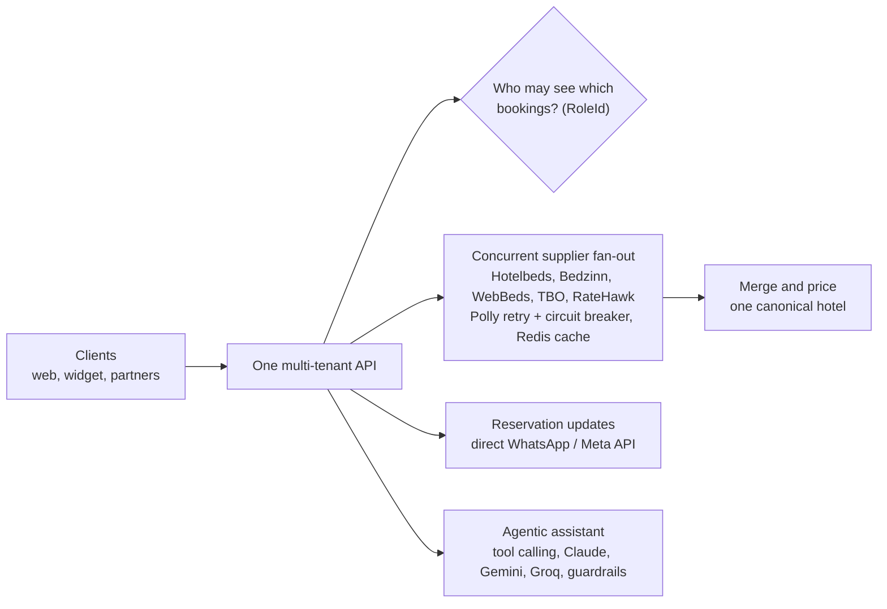

<h1 align="center">Gerges Tharwat</h1>

  <b>.NET Software Engineer &middot; Backend, APIs &amp; Agentic AI</b> 
  Cairo, Egypt

  
  

.NET backend engineer with ~4 years of experience building multi-tenant travel-booking platforms, high-volume supplier
integrations (Hotels and Flights providers), WhatsApp Integration and an agentic, tool-calling booking assistant. Strong in
ASP.NET Core, clean architecture, MongoDB/SQL Server and resilient distributed systems. Owns work end to end, from design
through certification and deployment.

---

## How I got here

| When | Where | What I did |
| --- | --- | --- |
| Jul 2022 &ndash; Feb 2023 | VB Solution | **.NET Backend Developer Intern.** Built APIs and endpoints for web applications using ASP.NET Core. |
| Feb 2023 &ndash; Mar 2024 | Egyptian Armed Forces (military service) | **Full Stack .NET Developer.** Delivered full projects on .NET Core (MVC, Web API) using Onion Architecture to build loosely coupled applications. |
| Feb &ndash; Jun 2024 | Microfilm Egypt | **Software Engineer, .NET Developer.** Delivered solutions in .NET Core (ASP.NET Web API and MVC): database design, unit tests, integration with other software, and deployment, including a high-throughput digital archiving engine with background processing queues. |
| Jun 2024 &ndash; now | Techeffic &#124; Depkey Group | **Full-Stack Software Engineer.** Own the backend of a multi-tenant (B2C / B2B / B2E) travel booking platform, its supplier integrations and meta-search, and an agentic, LLM-orchestrated booking assistant, working in .NET Core with hands-on Angular. |

Education: B.Sc. Computer Science, Software Engineering, Ahram Canadian University (ACU), 2018&ndash;2022 &middot; graduation project grade 4.00 (A) &middot; Training ITI .NET Core web development (2021).

---

## Featured engineering projects, in the order I would explain them

**1. Multi-tenant booking platform and extranet.**
Architected a single-backend, multi-tenant (B2C / B2B / B2E) travel booking system serving multiple corporate clients for
corporate ticketing and reservations, with tenant isolation. Designed an Extranet inventory module for direct booking of
self-owned hotel inventory, and refactored the core authentication/authorization project with granular role-based access
control (RBAC) restricting booking access by RoleId. Integrated WhatsApp/Meta APIs directly (bypassing middleman
providers) to send transactional reservation updates.
&rarr; Template: [**rbac-role-families**](https://github.com/SWE-Gerges/rbac-role-families) and
[**whatsapp-cloud-notifications**](https://github.com/SWE-Gerges/whatsapp-cloud-notifications)

**2. Meta-search aggregation engine.**
Engineered an asynchronous meta-search and aggregation engine integrating with global travel platforms (Wego, Google,
Trivago, SeatPick) and direct suppliers. Personally integrated Hotelbeds and Bedzinn; optimized WebBeds, TBO, RateHawk and
Hotelbeds transfers. Secured the official provider API certifications that gate live-data production access. Aggregated
rates from multiple providers concurrently, and handled latency variance and rate limits with Redis distributed caching
and Polly policies (Retry, Circuit Breaker). Led the migration of 5M+ supplier hotel records (static data) from MSSQL to
MongoDB, with a dynamic C# mapper that reads provider-specific collections and maps them to standard DTOs for search.
&rarr; Template: [**hotel-supplier-hub**](https://github.com/SWE-Gerges/hotel-supplier-hub) and
[**mongo-content-store**](https://github.com/SWE-Gerges/mongo-content-store)

**3. Agentic AI travel advisor (LLM orchestrator).**
Architected an end-to-end agentic booking assistant (widget and standalone site) that goes beyond Q&A: through a
conversational interface it calls the platform's business APIs as tools and walks the customer through search, pricing,
traveller details, payment and booking status for flights, hotels and transfers. Integrated multiple LLMs (Claude,
Gemini, Groq) behind a model-switching abstraction with one-click switching, and built an Orchestrator (agent loop) with
tool calling that routes user intents to specialized tools and runs multi-step flows until the booking is complete. A
pre-processing Guard Layer redacts PII and payment card numbers, with rate limiting and abuse prevention to control
inference costs. Own the deployment lifecycle: server configuration, CI/CD pipelines and high-availability hosting.
&rarr; Template: [**llm-booking-agent**](https://github.com/SWE-Gerges/llm-booking-agent)

Earlier work: an **enterprise digital archiving engine** at Microfilm Egypt (high-throughput document management and batch
indexing, background queues, SQL tuning for millions of records) and a **decoupled enterprise portal** on Onion (Clean)
Architecture during military service.

---

## Templates, not the original code

> **The linked repositories are templates that demonstrate the designs above. They are not the original code, which is
> proprietary.** They use in-memory fakes instead of real suppliers or providers, are generic by design, and run with
> only the .NET SDK. Each README says plainly what is tested and what is not.

| Template | What it shows | CI |
| --- | --- | --- |
| [**llm-booking-agent**](https://github.com/SWE-Gerges/llm-booking-agent) | A provider-agnostic agent loop with tool policies, where money and identity are owned by the server, never the model. |  |
| [**whatsapp-cloud-notifications**](https://github.com/SWE-Gerges/whatsapp-cloud-notifications) | An outbox, signed webhooks, delivery receipts, the 24-hour window rule, and a state for "we do not know if it was sent". |  |
| [**mongo-content-store**](https://github.com/SWE-Gerges/mongo-content-store) | Tolerant decoding of messy supplier data, a resumable MongoDB-to-OpenSearch sync, and a versioned index swapped by alias. |  |
| [**hotel-supplier-hub**](https://github.com/SWE-Gerges/hotel-supplier-hub) | Resilient fan-out to suppliers with different protocols, canonical hotel identities, and quotes that book exactly what was shown. |  |
| [**rbac-role-families**](https://github.com/SWE-Gerges/rbac-role-families) | Roles grouped into families whose strategy produces the query itself, so lists and single lookups cannot disagree. |  |

---

## Stack

  
  
  
  
  
  
  
  
  
  

**Languages:** C#, JavaScript/TypeScript, SQL, Python, Java, C++ 
**Backend:** .NET 8, ASP.NET Core (Web API, MVC), Entity Framework Core, Dapper, REST API design &amp; versioning, Hangfire, Polly 
**Data &amp; caching:** SQL Server, MongoDB, PostgreSQL, MySQL, Redis (distributed caching) 
**AI / LLM:** Agentic AI, LLM orchestration, tool/function calling (Claude, Gemini, Groq), multi-model abstraction, guardrails (PII redaction, rate limiting) 
**Architecture:** Clean/Onion Architecture, multi-tenancy, RBAC, Repository &amp; Unit of Work, CQRS 
**DevOps &amp; testing:** Docker, Git, CI/CD pipelines, server configuration, xUnit, NUnit, Moq

---

  Want to talk about backend design, supplier integrations or agentic AI?
  <a href="https://www.linkedin.com/in/gergestharwat/">LinkedIn</a> &middot; <a href="mailto:swe.gerges@gmail.com">swe.gerges@gmail.com</a>

