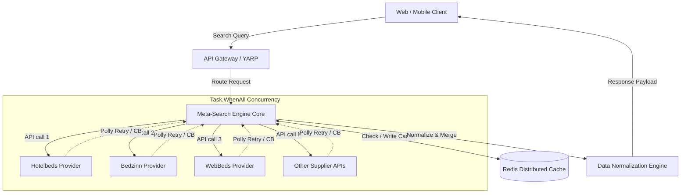
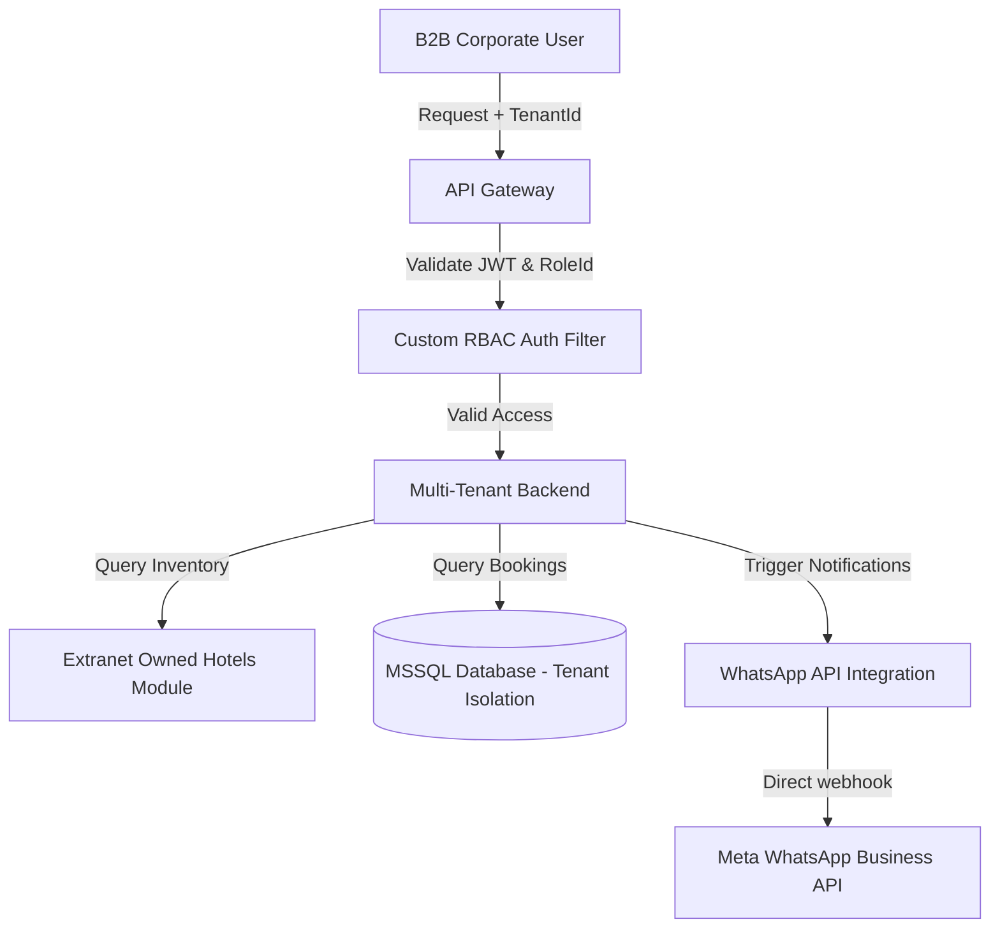

# Hi, I'm Gerges Tharwat 👋
###  Software Engineer | .NET Backend & Integration Specialist

I am a  Software Engineer specializing in designing, building, and optimizing high-performance distributed systems, multi-tenant architectures, and complex third-party API integrations using **.NET Core**, **MSSQL**, and **MongoDB**. 

My core focus is on building resilient travel technology platforms, high-concurrence meta-search engines, and robust security frameworks.

---

## 🛠️ Tech Stack

- **Languages**: C# (Expert), JavaScript/TypeScript, C++, Java, Python
- **Frameworks**: .NET Core/.NET 8, ASP.NET Core (Web API, MVC), Angular
- **Databases & Caching**: SQL Server (MSSQL), MySQL, PostgreSQL, MongoDB, Redis (Distributed Caching)
- **Architecture**: Clean Architecture, Domain-Driven Design (DDD), Microservices, CQRS, Repository & Unit of Work, Multi-Tenant Isolation
- **Testing & Tools**: xUnit, NUnit, Moq, Docker, Hangfire, Polly, Git

---

## 🏗️ System Architecture Case Studies

The following case studies outline the architecture of enterprise-scale proprietary platforms I have designed and built.

### Case Study 1: High-Performance Travel Meta-Search Engine & Aggregator
Engineered an asynchronous meta-search aggregation engine that queries and consolidates hotel and transfer rates from multiple global suppliers concurrently.

#### Architecture Flow:

#### Core Engineering Challenges Solved:
1. **Parallel Concurrency**: Utilized C# task parallelism (`Task.WhenAll`) to query multiple external APIs simultaneously, reducing aggregate response times by 50%+.
2. **Fault Tolerance & Resilience**: Implemented policies via **Polly** (Retry with jitter, Circuit Breaker, and Timeouts) to prevent slow or unresponsive supplier APIs from locking main system threads.
3. **Cache Mitigation**: Integrated a **Redis** distributed cache layer to cache hotel static data and active query results, mitigating provider rate limits and reducing database overhead.
4. **Static Data Migration**: Migrated over 5M supplier hotel records from MSSQL to **MongoDB**. Designed a dynamic C# mapper to query provider-specific collections and map them into standardized DTOs on the fly.

---

### Case Study 2: Multi-Tenant Booking Platform & Extranet (B2E/B2B)
Designed a single-backend, multi-tenant travel reservation portal enabling corporate enterprises (B2E) to manage bookings, ticket allocations, and direct-owned hotel inventories.

#### Architecture Flow:

#### Core Engineering Challenges Solved:
1. **Tenant Isolation**: Engineered a database strategy to isolate corporate transaction logs and booking details securely based on incoming `TenantId`.
2. **Granular RBAC**: Refactored the core authentication project to enforce custom Role-Based Access Control (RBAC), mapping permissions based on `RoleId` to govern booking edit/view rights.
3. **Direct Meta Integration**: Built a custom SMS/Notification handler communicating directly with the **Meta WhatsApp Business API** for transactional updates, bypassing costly third-party notification middle-men.
4. **Extranet Inventory**: Created a module enabling hotels owned directly by the client to load rates, availability, and inventory directly into the system, bypassing third-party GDS fees.

---

## 📬 Connect With Me

- **LinkedIn**: [https://www.linkedin.com/in/gergestharwat/](https://www.linkedin.com/in/gergestharwat/)
- **Email**: [swe.gerges@gmail.com](mailto:swe.gerges@gmail.com)

<!---
SWE-Gerges/SWE-Gerges is a ✨ special ✨ repository because its `README.md` (this file) appears on your GitHub profile.
You can click the Preview link to take a look at your changes.
--->
