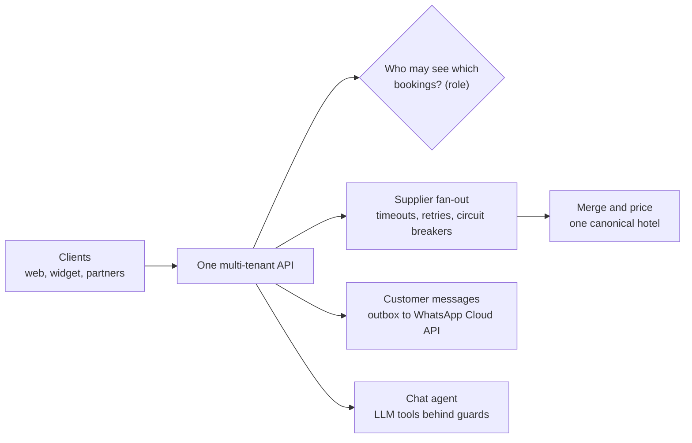

<h1 align="center">Gerges Tharwat</h1>

  <b>.NET Software Engineer &middot; Backend, APIs &amp; AI integrations</b> 
  Cairo, Egypt

  
  

I build the backend of travel-booking platforms: many tenants on one API, many hotel and transfer suppliers behind one
contract, and a chat agent that can take a booking all the way to payment without ever being trusted with the price.
About four years of production .NET, and the last two on a multi-tenant travel platform.

---

## How I got here

| When | Where | What I did |
| --- | --- | --- |
| Jul 2022 &ndash; Feb 2023 | VB Solution | **.NET backend intern.** My first APIs and endpoints in ASP.NET Core. |
| Feb 2023 &ndash; Mar 2024 | National service | **Full-stack .NET developer.** Whole projects on ASP.NET Core MVC and Web API, built on Onion architecture so they stayed loosely coupled. |
| Feb &ndash; Jun 2024 | Microfilm Egypt | **.NET developer.** A document-archiving system with background queues, and SQL tuning for millions of records. |
| Jun 2024 &ndash; now | Techeffic &#124; Depkey Group | **Full-stack engineer.** I own the backend of a multi-tenant travel platform, its supplier integrations and meta-search, and an LLM-orchestrated booking chatbot. |

Education: B.Sc. Computer Science (Software Engineering), Ahram Canadian University, 2018&ndash;2022 &middot; graduation project graded 4.00 (A) &middot; ITI .NET Core web development track.

---

## What I work on, in the order I would explain it

**1. One platform, many tenants.**
A single backend serves B2C, B2B and corporate (B2E) clients with tenant isolation. I refactored the core
authentication and authorization project to give it granular role-based access control, so what a user can see of a
booking depends on their role. I also designed the extranet module that lets a client sell its own hotel inventory
directly.
&rarr; Reference implementation: [**rbac-role-families**](https://github.com/SWE-Gerges/rbac-role-families)

**2. Many suppliers, one answer.**
An asynchronous meta-search and aggregation engine that queries hotel and transfer suppliers at the same time and
copes with their different latencies and rate limits (Redis caching, Polly retries and circuit breakers). I took
supplier integrations through the providers' certification audits that gate live data, and migrated 5M+ supplier hotel
records from SQL Server to MongoDB behind a mapper that turns provider-specific documents into one standard shape.
&rarr; Reference implementations: [**hotel-supplier-hub**](https://github.com/SWE-Gerges/hotel-supplier-hub) and
[**mongo-content-store**](https://github.com/SWE-Gerges/mongo-content-store)

**3. Telling the customer, reliably.**
Transactional reservation updates sent through the Meta WhatsApp Cloud API directly, instead of through a middleman
provider. The hard part is not sending one message but never sending it twice and knowing what to do when the answer
is lost.
&rarr; Reference implementation: [**whatsapp-cloud-notifications**](https://github.com/SWE-Gerges/whatsapp-cloud-notifications)

**4. A chat agent that can book, but cannot be talked into anything.**
An LLM-orchestrated assistant where users search, manage and pay for flights, hotels and transfers in conversation.
Claude, Gemini and Groq sit behind one switchable abstraction, a guard layer redacts personal and card data before the
model sees it, and rate limiting keeps inference cost under control. I also own its deployment: servers, CI/CD and
hosting.
&rarr; Reference implementation: [**llm-booking-agent**](https://github.com/SWE-Gerges/llm-booking-agent)

---

## Open-source reference implementations

Five repositories, each runnable with only the .NET SDK, each with architecture decision records and a README that says
plainly what is tested and what is not.

| Repository | What it shows | CI |
| --- | --- | --- |
| [**llm-booking-agent**](https://github.com/SWE-Gerges/llm-booking-agent) | A provider-agnostic agent loop with tool policies, where money and identity are owned by the server, never the model. |  |
| [**whatsapp-cloud-notifications**](https://github.com/SWE-Gerges/whatsapp-cloud-notifications) | An outbox, signed webhooks, delivery receipts, the 24-hour window rule, and a state for "we do not know if it was sent". |  |
| [**mongo-content-store**](https://github.com/SWE-Gerges/mongo-content-store) | Tolerant decoding of messy supplier data, a resumable MongoDB-to-OpenSearch sync, and a versioned index swapped by alias. |  |
| [**hotel-supplier-hub**](https://github.com/SWE-Gerges/hotel-supplier-hub) | Resilient fan-out to suppliers with different protocols, canonical hotel identities, and quotes that book exactly what was shown. |  |
| [**rbac-role-families**](https://github.com/SWE-Gerges/rbac-role-families) | Roles grouped into families whose strategy produces the query itself, so lists and single lookups cannot disagree. |  |

These are original code written to demonstrate the patterns. They use fakes instead of real suppliers or providers, and
none of them contains an employer's code or data.

---

## Stack

  
  
  
  
  
  
  
  
  
  

**Backend:** ASP.NET Core Web API and MVC, EF Core, Dapper, REST design and versioning, Hangfire, Polly 
**Architecture:** clean and onion architecture, multi-tenancy, RBAC, repository and unit of work, CQRS 
**AI:** LLM orchestration and tool calling (Claude, Gemini, Groq), multi-model abstraction, PII redaction, rate limiting 
**Testing and delivery:** xUnit, NUnit, Moq, CI/CD pipelines, Git

---

  Want to talk about backend design, supplier integrations or LLM agents?
  <a href="https://www.linkedin.com/in/gergestharwat/">LinkedIn</a> &middot; <a href="mailto:swe.gerges@gmail.com">swe.gerges@gmail.com</a>

